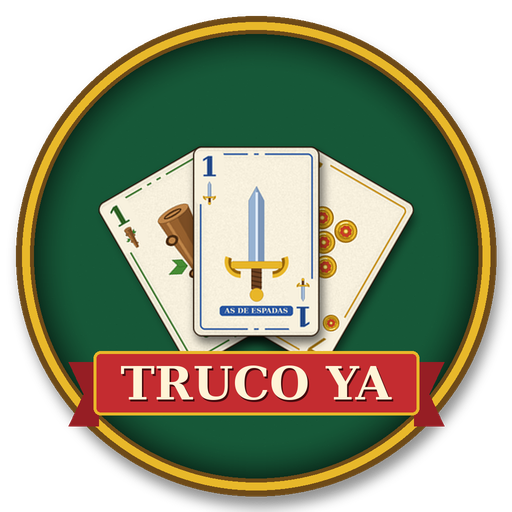
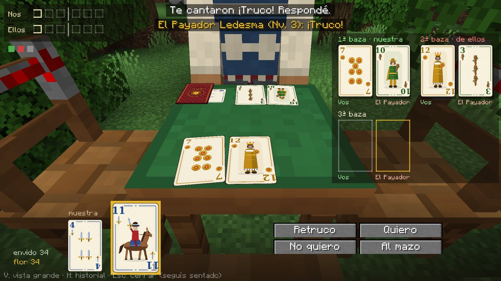
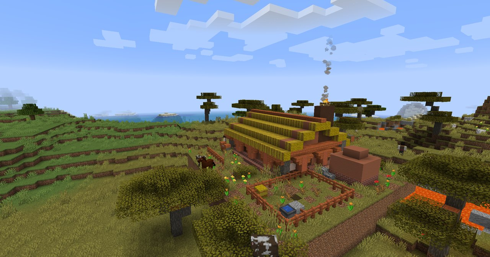
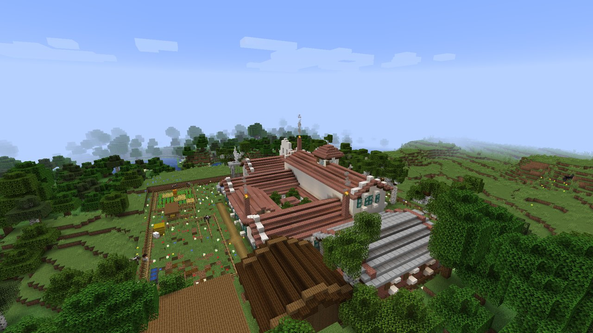
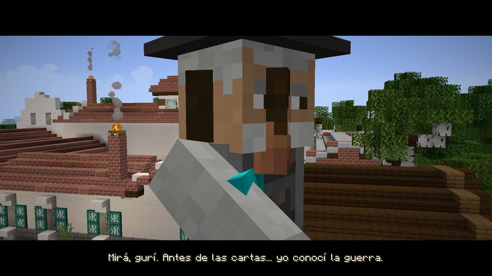
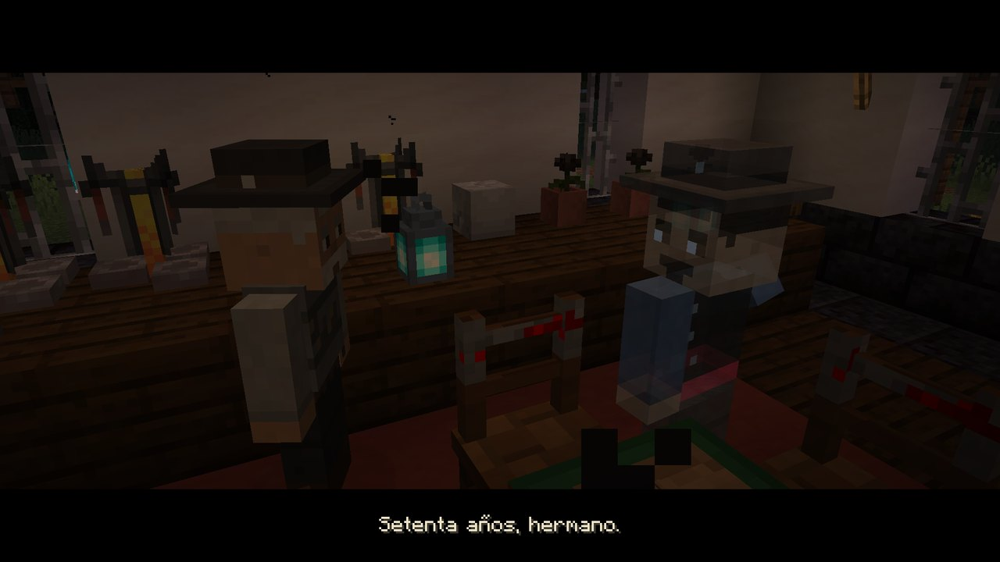

<div align="center">



# Truco Ya

**El truco uruguayo dentro de Minecraft.**

[](https://modrinth.com/mod/truco-ya)
[](https://www.minecraft.net)
[](https://files.minecraftforge.net)
[](LICENSE)
[](https://github.com/Nicrolax/Grupo1_proyecto/actions/workflows/build.yml)



</div>

Truco Ya es un mod para Minecraft Java 1.16.5 (Forge) para jugar al **truco uruguayo con las reglas de
verdad**: muestra, piezas, envido, flor y contraflor, truco y vale cuatro, malas y buenas. Se juega contra
paisanos con inteligencia artificial o con amigos en un servidor, y trae un **modo historia** que recorre las
pulperías del Uruguay hasta el Viejo Vizcacha y la leyenda de la Salamanca.

> *A Minecraft 1.16.5 Forge mod to play Uruguayan Truco (muestra, piezas, flor) against AI gauchos or friends,
> with a story mode through the countryside. The game is in Spanish.*

---

## ✨ Características

- 🃏 **Truco uruguayo completo**: muestra y piezas, envido, real envido y falta envido, flor, contraflor y
  "con flor me achico", truco, retruco y vale cuatro, pardas, partidos a 30 o 40 en malas y buenas. Los
  tantos se cantan como en la mesa: "son buenas".
- 🪑 **Mesa de Truco, Sillas Criollas y Anotador de porotos**: la baza en juego se ve sobre la mesa, y el tapete
  muestra solo lo que se puede hacer en cada momento.
- 🧉 **Paisanos con IA de cinco niveles** (y el Viejo Vizcacha, en un sexto), que leen la mesa, farolean y se hacen señas en el 2 contra 2.
- 🗺️ **Modo historia**: seis regiones con su pulpería, torneos, cuadreras, la Estancia del Caudillo, el
  Viejo Vizcacha, dos cinemáticas y el capítulo de La Salamanca contra el Mandinga.
- 🎴 **Diez barajas coleccionables**, pedidos de los paisanos, desafíos del día y la Libreta del Truquero.
- 🍖 **Cultura criolla**: mate, picada, bebidas, discos de milonga, candombe, vals y payada, armas gauchas.
- 🌐 **Multijugador**: el servidor es la única autoridad; cada cliente recibe solo su mano.

<div align="center">




</div>

## 📥 Descargas

- **Versión estable:** en [Modrinth](https://modrinth.com/mod/truco-ya).
- **Desde el código:** `gradlew build` (ver «Compilar desde el código», más abajo).
- **Novedades de cada versión:** [CHANGELOG.md](CHANGELOG.md).

## 🖥️ Instalación

1. Instalá [Forge 1.16.5-36.2.39](https://files.minecraftforge.net) (el "Installer").
2. Copiá a la carpeta `mods` de Minecraft (en Windows, `%appdata%\.minecraft\mods`):
   - `trucoya-1.7.6.jar`;
   - **[GeckoLib 3.0.106](https://modrinth.com/mod/geckolib)** para Forge 1.16.5 (dependencia obligatoria).
3. Abrí Minecraft con el perfil de Forge.
4. Poné una **Mesa de Truco** y una **Silla Criolla**, sentate y apretá **J**.

El mod va en el cliente **y** en el servidor. Para armar un servidor dedicado, ver [docs/SERVIDOR.md](docs/SERVIDOR.md).

## 🎮 Cómo se juega

Todo está en el [**Manual**](docs/MANUAL.md): controles, reglas implementadas, el modo historia, los
comandos y las opciones del servidor. La historia de La Salamanca está en [docs/SALAMANCA.md](docs/SALAMANCA.md).

## 📬 Reportar problemas

¿Encontraste un error o tenés una idea? Abrí un [issue](https://github.com/Nicrolax/Grupo1_proyecto/issues/new/choose)
con la plantilla que corresponda. Para un error, adjuntá el `latest.log` (carpeta `.minecraft/logs`) y,
si el juego se cerró, el reporte de `.minecraft/crash-reports`.

## 🛠️ Compilar desde el código

Requisitos: **JDK 8** (Eclipse Temurin recomendado). Gradle viene con el proyecto.

```
gradlew coreTests    # pruebas del motor de truco
gradlew runClient    # abre Minecraft con el mod
gradlew build        # deja el .jar en build/libs/
```

En Windows también se puede con doble clic:

| Script | Qué hace |
|---|---|
| `scripts\probar.bat` | Baja el JDK 8, corre las pruebas y compila. |
| `scripts\jugar.bat` | Abre Minecraft con el mod. |
| `scripts\armar_jar.bat` | Deja el `.jar` y GeckoLib en `entrega/` (no se sube al repositorio). |
| `scripts\servidor.bat` | Arma un servidor dedicado. |

Cómo está armado el código: [Arquitectura](docs/MANUAL.md#arquitectura) y [diagramas UML](docs/04-uml.md).
Para colaborar, ver [CONTRIBUTING.md](CONTRIBUTING.md).

## 📚 Documentación del proyecto

Proyecto del curso Programación Avanzada (UTU).

| # | Documento | Contenido |
|---|---|---|
| 1 | [Situación problema](docs/01-situacion-problema.md) | Contexto, problema, actores, alcance y alternativas. |
| 2 | [Requisitos](docs/02-requisitos.md) | Requisitos funcionales y no funcionales, con criterios medibles. |
| 3 | [Stack tecnológico](docs/03-stack-tecnologico.md) | Cada tecnología, su versión y por qué se eligió. |
| 4 | [Diagramas UML](docs/04-uml.md) | Clases, secuencia y estados (fuentes en [`docs/uml/`](docs/uml/)). |
| 5 | [Casos de uso](docs/05-casos-de-uso.md) | Diagrama y 15 descripciones. |
| 6 | [Infraestructura](docs/06-infraestructura.md) | Despliegue, protocolos, puertos y mensajes de red. |
| 7 | [Pruebas](docs/07-pruebas.md) | Pruebas automáticas y guía de prueba en vivo. |
| 8 | [Calidad del código](docs/08-calidad.md) | Análisis estático (PMD) y buenas prácticas. |
| — | [Informe en PDF](docs/Informe_TrucoYa.pdf) | Toda la documentación en un archivo. |

## 🤖 Uso de inteligencia artificial

Lo decimos claro, como pide [Modrinth](https://support.modrinth.com/en/articles/16551575):

- **Del Grupo 1:** la idea, el diseño del juego y de la historia, las reglas del truco uruguayo, las
  decisiones, las pruebas en vivo y las voces grabadas de los cuatro Fundadores.
- **Con asistencia de IA (Claude, de Anthropic):** gran parte del código Java y de las herramientas en Python
  que generan texturas, estructuras, música y sonidos, y parte de la documentación.
- **Voces sintéticas:** los cantos de los paisanos y las voces del Vizcacha, el Mandinga y Ledesma se hicieron
  con modelos de texto a voz (Kokoro-82M y Piper). Las felicitaciones finales de los Fundadores se hicieron
  clonando sus propias grabaciones, con su permiso (XTTS-v2).
- **Imágenes:** no se usaron generadores de imágenes. Las texturas, los modelos y el logo los dibujan programas
  propios pixel por pixel (`tools/`), escritos con asistencia de IA. Las capturas son del juego.

## 👥 Créditos

**Grupo 1 — los Fundadores:** Nicolás Bentancour, Agustín Perdomo, Matías Piñeyro y Thiago Rodríguez.

Las bibliotecas, modelos y obras de terceros que usa el proyecto, con sus licencias, están en
[CREDITOS.md](CREDITOS.md).

## 📜 Licencia

El código es [MIT](LICENSE). Algunos recursos de terceros tienen su propia licencia: ver
[CREDITOS.md](CREDITOS.md).

Minecraft es una marca de Mojang Studios. Este proyecto no está afiliado a Mojang ni a Microsoft.
