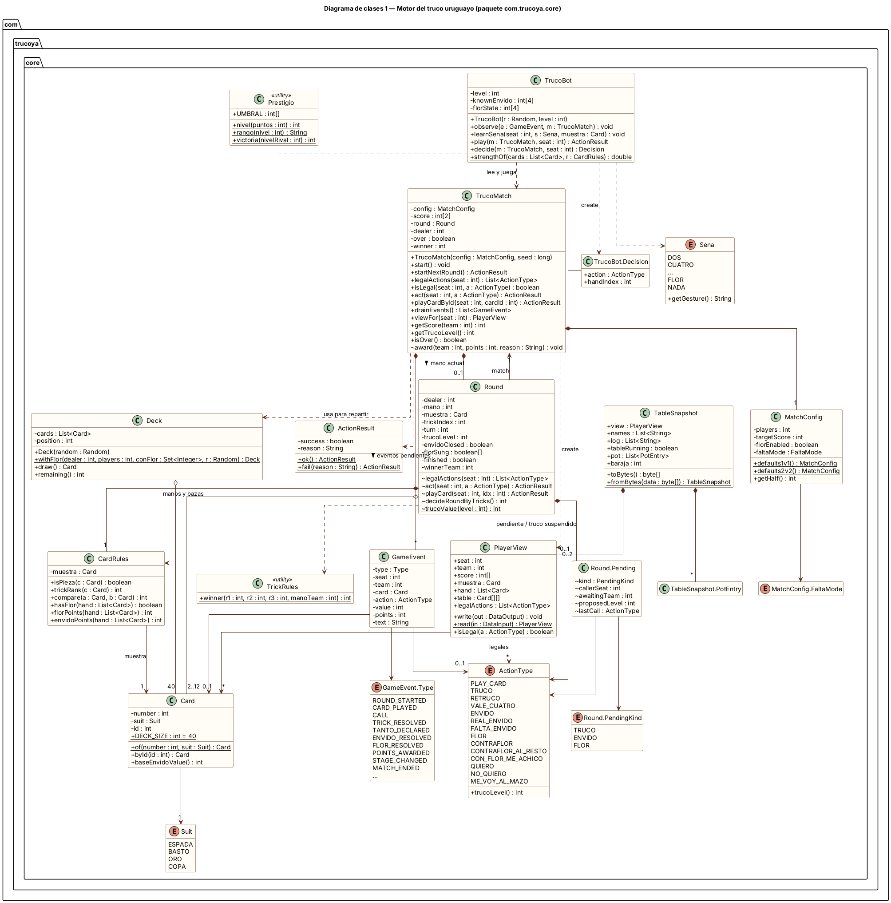
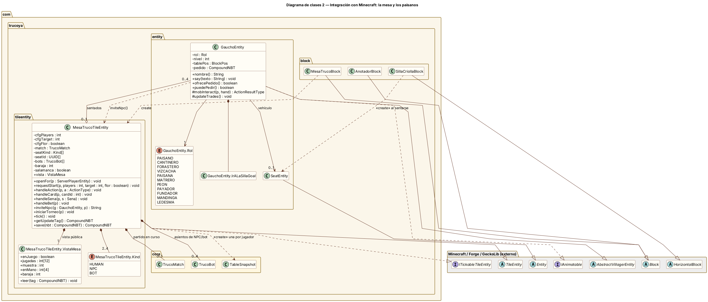
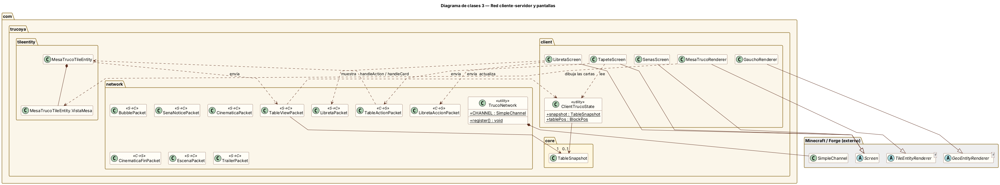
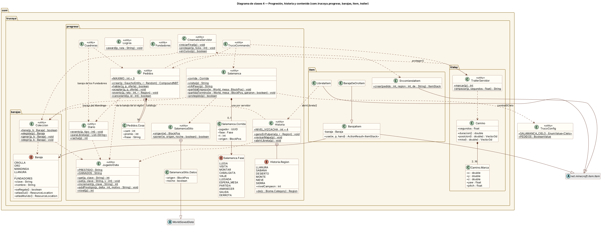
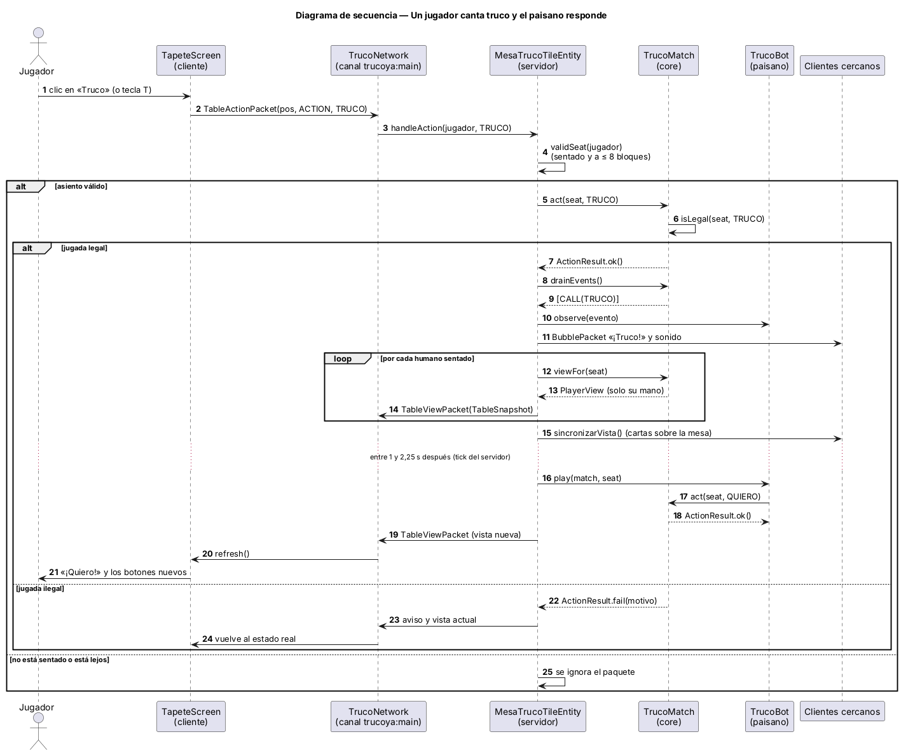
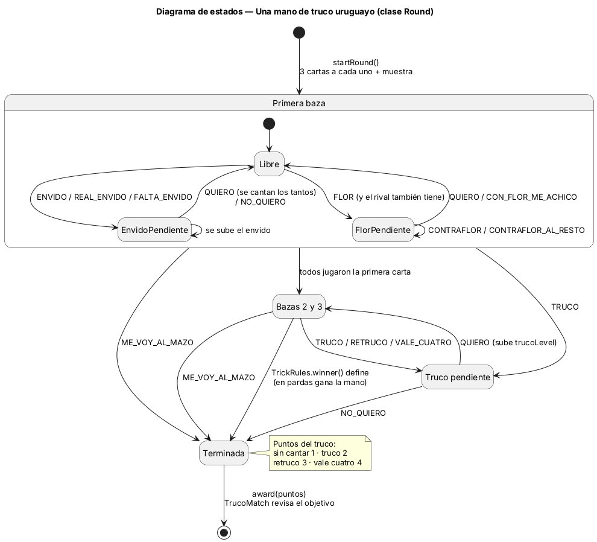
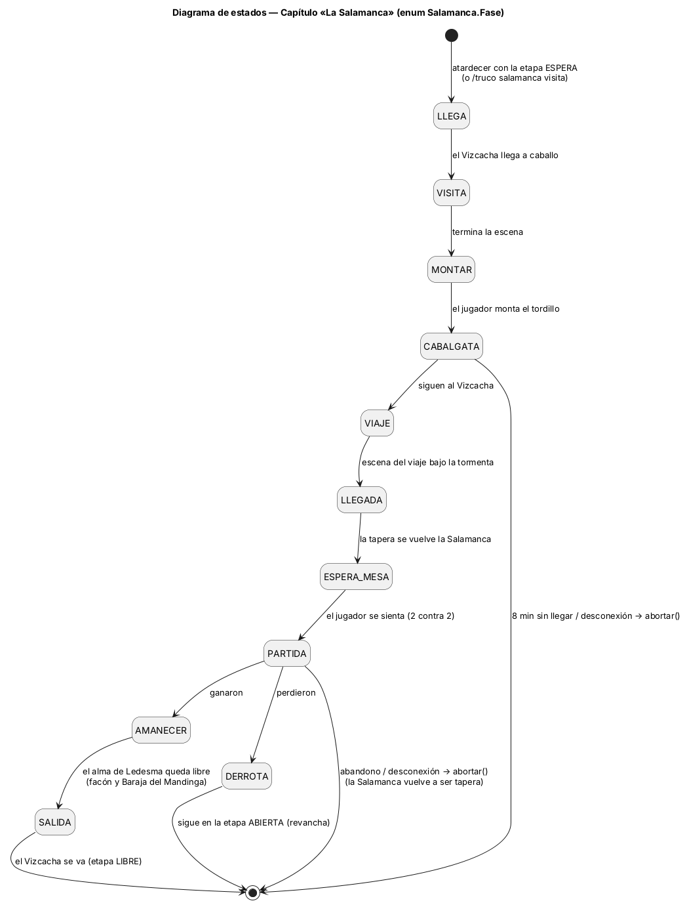

# 4. Diagramas UML

Los diagramas están escritos en PlantUML, en [`docs/uml/`](uml/), y se dibujaron a partir del código real.
Las imágenes están en [`docs/img/`](img/), en SVG y PNG.

Para volver a dibujarlos:

```
java -jar plantuml.jar -tsvg -o ../img docs/uml/*.puml
```

**Notación:**

| Símbolo | Significado |
|---|---|
| `+` | público |
| `-` | privado |
| `#` | protegido |
| `~` | de paquete |
| subrayado | estático |
| ◆ (composición) | la parte vive dentro del todo |
| ◇ (agregación) | la parte existe por su cuenta |
| línea punteada | dependencia / «create» |
| triángulo vacío | herencia o realización |

Las cardinalidades están en cada extremo. Las clases de Minecraft, Forge y GeckoLib aparecen en gris, solo
cuando hace falta mostrar la herencia.

## 4.1 Diagrama de clases 1: el motor del truco (`com.trucoya.core`)

Este es el corazón del sistema y no depende de Minecraft:
- `TrucoMatch` lleva el partido completo y crea una `Round` por cada mano.
- `Round` aplica todas las reglas de la mano: bazas, envido, flor, truco y pardas.
- `CardRules` resuelve la muestra y las piezas.
- `TrucoBot` es la inteligencia artificial de los paisanos.
- `PlayerView` es lo único que ve cada jugador.



## 4.2 Diagrama de clases 2: la mesa y los paisanos

- `MesaTrucoTileEntity` es el bloque-entidad de la mesa en el servidor. Contiene el `TrucoMatch`, los `TrucoBot` de los asientos que no son humanos y la vista pública (`VistaMesa`) que ven los demás jugadores.
- `GauchoEntity` es el paisano: hereda de `AbstractVillagerEntity` para comerciar e implementa `IAnimatable` de GeckoLib.



## 4.3 Diagrama de clases 3: red y pantallas

- El cliente solo manda intenciones (`TableActionPacket`).
- El servidor responde con un `TableSnapshot` por jugador (`TableViewPacket`), que el cliente guarda en `ClientTrucoState` y dibuja en `TapeteScreen`.
- Las cartas sobre la mesa en el mundo las dibuja `MesaTrucoRenderer` a partir de `VistaMesa`.



## 4.4 Diagrama de clases 4: progresión, historia y contenido

- El progreso de cada jugador vive en sus datos persistentes (`JugadorData`, NBT).
- `Historia` maneja regiones, sellos y la Libreta.
- `Pedidos`, `Diario` y `Coleccion` son los pedidos, los desafíos y las barajas.
- `Salamanca` es una máquina de estados (`Fase`), con una sola corrida por servidor.
- `TrailerServidor` y `Camino` forman el modo tráiler.



## 4.5 Diagrama de secuencia: cantar truco

Muestra el viaje completo de una jugada: el clic en el cliente, la validación en el servidor, la
actualización privada a cada jugador y la respuesta del paisano.



## 4.6 Diagramas de estados

**Una mano (`Round`):**



**El capítulo La Salamanca (`Salamanca.Fase`):**


