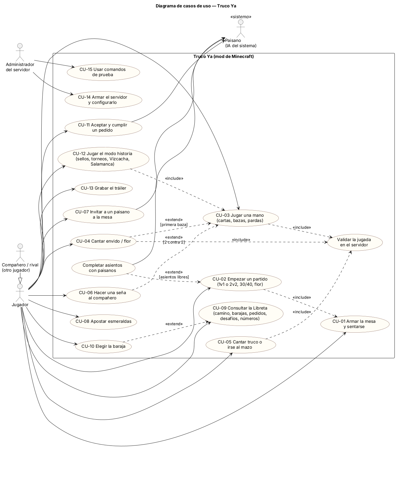

# 5. Casos de uso

## 5.1 Actores

| Actor | Tipo | Descripción |
|---|---|---|
| **Jugador** | Principal | Persona que juega Minecraft con el mod instalado. |
| **Compañero / rival** | Principal (es un Jugador) | Otro jugador en la misma mesa, en un servidor. |
| **Administrador del servidor** | Principal | Instala y configura el servidor dedicado; es operador (permiso nivel 2). |
| **Paisano (IA)** | Secundario, del sistema | NPC que juega, acepta invitaciones y ofrece pedidos. |

## 5.2 Diagrama

Fuente: [`uml/casos_de_uso.puml`](uml/casos_de_uso.puml).

## 5.3 Descripciones

### CU-01 Armar la mesa y sentarse
- **Actor:** Jugador. **Requisitos:** RF-01.
- **Precondición:** el jugador tiene una Mesa de Truco y al menos una Silla Criolla (se compran al pulpero o se fabrican).
- **Flujo principal:**
  1. El jugador coloca la mesa.
  2. Coloca una silla pegada a uno de sus lados.
  3. Hace clic derecho en la silla.
  4. El sistema lo sienta mirando hacia la mesa.
- **Postcondición:** el jugador ocupa un asiento de esa mesa.

### CU-02 Empezar un partido
- **Actor:** Jugador. **Requisitos:** RF-02, RF-10.
- **Precondición:** el jugador está sentado (incluye CU-01) y la mesa no tiene un partido en curso.
- **Flujo principal:**
  1. El jugador abre el tapete (clic en la mesa o tecla J).
  2. Elige modo (1v1 o 2v2), puntos (30 o 40) y si se juega con flor.
  3. Aprieta «Empezar».
  4. El sistema completa los asientos libres con paisanos (*extend*: «Completar asientos con paisanos»).
  5. El sistema reparte y muestra la mano.
- **Alternativos:**
  - 3a. Si hay 3 o 4 humanos sentados y se eligió 1 contra 1, el sistema pide elegir 2 contra 2.
  - 3b. En la Salamanca solo puede empezar el jugador de esa noche, y hacen falta los cuatro sentados.
  - 3c. En la Guarida Clandestina hace falta nivel 3 de prestigio o una Ficha Clandestina.
- **Postcondición:** hay un `TrucoMatch` en curso, con la primera mano repartida y la muestra a la vista.

### CU-03 Jugar una mano
- **Actor:** Jugador; Paisano (rival o compañero). **Requisitos:** RF-03, RF-04, RF-08, RF-13.
- **Precondición:** hay un partido en curso y es el turno del jugador.
- **Flujo principal:**
  1. El jugador elige una carta (clic o tecla 1 a 3).
  2. El cliente manda la intención al servidor.
  3. El sistema valida asiento, distancia y turno (*include*: «Validar la jugada en el servidor»).
  4. El sistema pone la carta en la baza.
  5. El sistema actualiza la vista privada de cada jugador y la mesa en el mundo.
  6. Al completarse la baza, el sistema la resuelve.
  7. Al decidirse la mano, el sistema anota los puntos.
- **Alternativos:**
  - 3a. Jugada ilegal o fuera de turno: el sistema la rechaza con un mensaje y no cambia nada.
  - 6a. Parda: la baza no es de nadie y se sigue según las reglas de pardas.
- **Postcondición:** la carta queda jugada y el estado es el mismo en el servidor y en todos los clientes.

### CU-04 Cantar envido o flor
- **Actor:** Jugador. **Requisitos:** RF-05, RF-06, RF-09.
- **Precondición:** primera baza (*extend* de CU-03), envido o flor todavía abiertos y el canto es legal en ese momento.
- **Flujo principal:**
  1. El jugador aprieta «Envido», «Real envido», «Falta envido» o «Flor».
  2. El sistema valida el canto (*include*).
  3. El rival responde «Quiero», «No quiero» o sube el canto.
  4. Si se quiere, los jugadores cantan sus tantos empezando por la mano.
  5. El sistema calcula los tantos (con piezas), decide el ganador y anota.
- **Alternativos:**
  - 1a. Con flor en la mano, el envido no está disponible: hay que cantar flor.
  - 3a. «Con flor me achico»: suma 3 puntos al que cantó la flor.
  - 3b. Contraflor al resto con un equipo en malas y el otro en buenas: vale lo que le falta al que va ganando.
- **Postcondición:** el envido o la flor quedan cerrados para esa mano, y los puntos anotados en malas o buenas.

### CU-05 Cantar truco o irse al mazo
- **Actor:** Jugador. **Requisitos:** RF-07.
- **Precondición:** partido en curso y el jugador tiene derecho a cantar o subir.
- **Flujo principal:**
  1. El jugador canta «Truco».
  2. El sistema valida (*include*).
  3. El rival quiere, no quiere o sube a «Retruco».
  4. El jugador puede subir a «Vale cuatro».
  5. Al terminar la mano, el sistema anota según el nivel querido.
- **Alternativos:**
  - 3a. «No quiero»: el que cantó se lleva los puntos del nivel anterior y la mano termina.
  - 1a. «Me voy al mazo»: el equipo pierde la mano. En 2v2, irse uno vale por todo el equipo.
- **Postcondición:** el nivel del truco de la mano queda actualizado, o la mano termina.

### CU-06 Hacer una seña al compañero
- **Actor:** Jugador; Compañero. **Requisitos:** RF-12.
- **Precondición:** partido 2v2 en curso.
- **Flujo principal:**
  1. El jugador aprieta G.
  2. Elige la seña (por ejemplo, «guiño de ojo» por el 2 de la muestra).
  3. El sistema se la muestra a su compañero.
- **Alternativo:** 3a. Con cierta probabilidad un rival la ve, y el sistema se lo avisa también a él.
- **Postcondición:** el compañero sabe qué carta importante tiene el jugador.

### CU-07 Invitar a un paisano a la mesa
- **Actor:** Jugador; Paisano. **Requisitos:** RF-11.
- **Precondición:** hay una Mesa de Truco con sillas libres a 24 bloques o menos del paisano.
- **Flujo principal:**
  1. El jugador hace clic derecho al paisano (agachado, si el paisano tiene un pedido).
  2. El paisano contesta.
  3. El paisano camina hasta la mesa y se sienta.
- **Alternativo:** 1a. No hay mesa cerca: el paisano le dice que ponga una.
- **Postcondición:** el paisano ocupa un asiento de la mesa.

### CU-08 Apostar esmeraldas
- **Actor:** Jugador. **Requisitos:** RF-14.
- **Precondición:** el jugador está sentado, la mesa no está jugando y tiene en la mano lo que apuesta (por ejemplo, esmeraldas; en la Guarida, solo oro, esmeraldas, diamantes o netherite).
- **Flujo principal:**
  1. El jugador aprieta «Apostar».
  2. El sistema pone lo apostado en el pozo y muestra quién apostó.
  3. Al terminar el partido, el sistema le da el pozo al equipo ganador.
- **Alternativo:** 2a. «Retirar» antes de empezar devuelve lo apostado. Solo funciona estando en la mesa.
- **Postcondición:** lo apostado queda en el pozo o vuelve al jugador.

### CU-09 Consultar la Libreta del Truquero
- **Actor:** Jugador. **Requisitos:** RF-17, RF-25.
- **Precondición:** el jugador tiene la Libreta (se recibe al entrar al mundo; `/truco historia` la repone).
- **Flujo principal:**
  1. El jugador hace clic derecho con la Libreta.
  2. El servidor manda los datos del jugador.
  3. El sistema muestra cuatro pestañas: Camino (capítulos, sellos y rumbo), Barajas, Pedidos (y desafíos del día) y Números.
- **Postcondición:** el jugador ve su progreso; no cambia nada.

### CU-10 Elegir la baraja
- **Actor:** Jugador. **Requisitos:** RF-23.
- **Precondición:** el jugador tiene la baraja en su colección (*extend* de CU-09).
- **Flujo principal:**
  1. En la pestaña Barajas, el jugador toca un mazo.
  2. Aprieta «Jugar con esta».
  3. El servidor valida que la tiene y la elige.
- **Alternativos:**
  - 1a. Clic derecho con el mazo en la mano, o `/truco baraja <clave>`.
  - 3a. Si no la tiene, el sistema dice cómo se gana.
- **Postcondición:** los próximos partidos que arme el jugador usan esa baraja.

### CU-11 Aceptar y cumplir un pedido
- **Actor:** Jugador; Paisano. **Requisitos:** RF-24.
- **Precondición:** un paisano muestra «¡Pedido!» y el jugador tiene menos de 3 pedidos.
- **Flujo principal:**
  1. El jugador hace clic derecho al paisano.
  2. El paisano cuenta qué necesita y el premio.
  3. El jugador vuelve a hacer clic (o aprieta [Aceptar] en el chat).
  4. El sistema anota el pedido.
  5. El jugador lo cumple: le lleva las cosas, entrega la encomienda en la región indicada o hace el desafío.
  6. El sistema le paga esmeraldas y prestigio.
- **Alternativos:**
  - 5a. Le faltan cosas: el paisano dice cuántas faltan.
  - 5b. El jugador cancela el pedido desde la Libreta o con `/truco pedidos cancelar <n>`.
- **Postcondición:** el pedido queda cumplido o cancelado, y no se puede volver a aceptar.

### CU-12 Jugar el modo historia
- **Actor:** Jugador. **Requisitos:** RF-15, RF-16, RF-18, RF-19, RF-20, RF-22.
- **Precondición:** el jugador empezó con su Libreta.
- **Flujo principal:**
  1. El jugador gana su primer partido.
  2. Busca las pulperías de las seis regiones y gana en cada una (*include* CU-03) para conseguir los sellos.
  3. Sube a nivel 4 de prestigio.
  4. Recibe el Mapa del Baqueano.
  5. Llega a la Estancia y ve la cinemática.
  6. Le gana al Viejo Vizcacha y recibe la Baraja de Oro.
  7. Ve la cinemática final.
  8. Otro día, el Vizcacha lo busca para La Salamanca.
- **Alternativos:**
  - 6a. Pierde: puede volver a desafiarlo.
  - 8a. Pierde en la Salamanca: queda la revancha.
- **Postcondición:** el avance queda guardado en los datos del jugador.

### CU-13 Grabar el tráiler
- **Actor:** Jugador (operador o dueño del mundo). **Requisitos:** RF-29.
- **Precondición:** el jugador no está en otra escena.
- **Flujo principal:**
  1. En cada lugar, el jugador mira hacia donde quiere que mire la cámara y escribe `/truco trailer marcar`.
  2. Escribe `/truco trailer 6`.
  3. El sistema recorre las marcas con la cámara de cine, carteles y música.
  4. Al final, el sistema devuelve al jugador a su lugar.
- **Alternativo:** 2a. Sin marcas, la cámara da una vuelta alrededor del jugador.
- **Postcondición:** el jugador está donde empezó; puede grabar la pantalla.

### CU-14 Armar el servidor y configurarlo
- **Actor:** Administrador. **Requisitos:** RF-27, RF-28.
- **Precondición:** PC con Windows y conexión a internet.
- **Flujo principal:**
  1. El administrador corre `servidor.bat`.
  2. El script compila el mod, instala Forge para servidor, consigue GeckoLib y pregunta por la EULA de Minecraft.
  3. El administrador arranca con `servidor\iniciar.bat`.
  4. Si quiere, edita `trucoya-server.toml`.
  5. Comparte la IP.
- **Alternativo:** 2a. Si la compilación falla, el script se detiene y no copia nada viejo.
- **Postcondición:** el servidor acepta jugadores con la misma versión del mod.

### CU-15 Usar comandos de prueba
- **Actor:** Administrador (operador). **Requisitos:** RF-30.
- **Precondición:** permiso nivel 2.
- **Flujo principal:**
  1. El operador escribe, por ejemplo, `/truco completar` o `/truco gaucho vizcacha`.
  2. El sistema aplica el cambio y lo confirma.
- **Alternativo:** 1a. Sin permiso, el comando no aparece y Minecraft lo rechaza.
- **Postcondición:** el progreso o el mundo quedan como pidió el operador.
