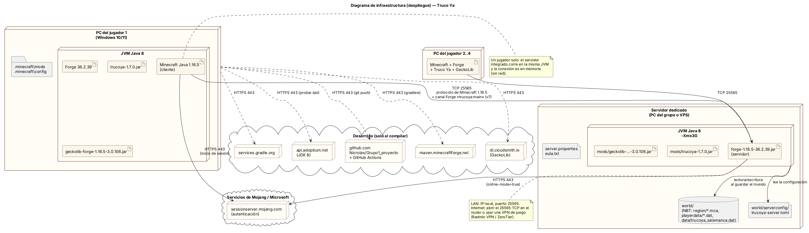

# 6. Diagrama de infraestructura

Fuente: [`uml/infraestructura.puml`](uml/infraestructura.puml).

## 6.1 Componentes de despliegue

| Componente | Dónde corre | Qué contiene |
|---|---|---|
| **Cliente** | PC de cada jugador (Windows 10/11), JVM Java 8 | Minecraft Java 1.16.5, Forge 36.2.39, `trucoya-1.7.0.jar` y `geckolib-forge-1.16.5-3.0.106.jar` en `.minecraft\mods`. Dibuja el mundo, las pantallas y el audio. |
| **Servidor dedicado** | PC del grupo o un VPS, JVM Java 8 (`-Xmx3G`) | `forge-1.16.5-36.2.39.jar` (servidor), con el mod y GeckoLib en `mods/`. Es la **autoridad** de todo: partidos, IA, progreso. |
| **Servidor integrado** | La misma JVM del cliente, al jugar solo | Igual que el dedicado, pero comunicado en memoria (sin red). |
| **Almacenamiento** ("base de datos") | Disco del servidor, carpeta `world/` | Formato NBT: `region/*.mca` (bloques y mesas), `playerdata/*.dat` (el progreso de cada jugador va dentro de `PlayerPersisted`) y `data/trucoya_salamanca.dat` (`WorldSavedData`). |
| **Configuración** | `world/serverconfig/trucoya-server.toml`, `server.properties`, `eula.txt` | Opciones del mod y del servidor. |
| **Autenticación** | `sessionserver.mojang.com` (Mojang/Microsoft) | Verifica la cuenta de cada jugador al entrar (`online-mode=true`). |
| **Repositorio e integración continua** | `github.com/Nicrolax/Grupo1_proyecto` y GitHub Actions | Código, documentación; compila y prueba en cada push. |
| **Repositorios de construcción** | `maven.minecraftforge.net`, `dl.cloudsmith.io`, `services.gradle.org`, `api.adoptium.net` | Solo para compilar: Forge, GeckoLib, Gradle y el JDK 8. No intervienen al jugar. |

## 6.2 Comunicaciones, protocolos y puertos

| Origen → destino | Protocolo | Puerto | Para qué |
|---|---|---|---|
| Cliente → servidor | TCP, protocolo de Minecraft 1.16.5 con el *handshake* de Forge | **25565** (por defecto, en `server.properties`) | Todo el juego. Por la misma conexión viaja el canal propio **`trucoya:main`** (Forge SimpleChannel, protocolo **v7**). Si el mod no coincide en versión, el cliente no entra. |
| Cliente y servidor → Mojang | HTTPS | 443 | Inicio de sesión y verificación de la cuenta. |
| PC de desarrollo → repositorios Maven, Gradle y Adoptium | HTTPS | 443 | Bajar dependencias al compilar (`gradlew`, `probar.bat`). |
| PC de desarrollo → GitHub | HTTPS | 443 | `git push`; GitHub Actions compila en la nube. |
| Un jugador solo | En memoria | — | El servidor integrado comparte la JVM con el cliente. |

## 6.3 Mensajes del canal `trucoya:main`

| Paquete | Dirección | Contenido | Límites |
|---|---|---|---|
| `TableActionPacket` | Cliente → servidor | Intención en una mesa: abrir, empezar, jugar carta, cantar, seña, apostar, torneo. | La posición de la mesa y los valores se validan en el servidor. |
| `TableViewPacket` | Servidor → cliente | `TableSnapshot`: la vista privada del jugador (`PlayerView`) y la mesa. | ≤ 16 KB |
| `BubblePacket` | Servidor → cliente | Globo de diálogo y canto (con voz). | ≤ 1 KB, 200 caracteres |
| `SenaNoticePacket` | Servidor → cliente | Aviso de seña. | ≤ 1 KB, 160 caracteres |
| `LibretaPacket` | Servidor → cliente | Progreso para la Libreta. | Listas ≤ 8, textos ≤ 1024 |
| `LibretaAccionPacket` | Cliente → servidor | Elegir baraja o cancelar un pedido. | Validado en el servidor |
| `CinematicaPacket`, `EscenaPacket`, `TrailerPacket` | Servidor → cliente | Empezar o cortar una cinemática, una escena o el tráiler. | ≤ 16 marcas |
| `CinematicaFinPacket` | Cliente → servidor | El cliente terminó de ver la escena. | — |

Además, la mesa sincroniza su vista pública (cartas jugadas, muestra, dorsos) con el paquete estándar de
bloque-entidad de Minecraft (`SUpdateTileEntityPacket`), solo cuando cambia.

## 6.4 Formas de desplegar

1. **Un jugador:** `jugar.bat` (desarrollo), o el `.jar` en `.minecraft\mods` con Forge instalado.
2. **LAN:** "Abrir en LAN" desde el juego, o servidor dedicado, con la IP local y el puerto 25565.
3. **Internet:** servidor dedicado (`servidor.bat`, ver [SERVIDOR.md](../SERVIDOR.md)), con el puerto 25565/TCP abierto en el router o con una VPN de juego (Radmin VPN, ZeroTier).
